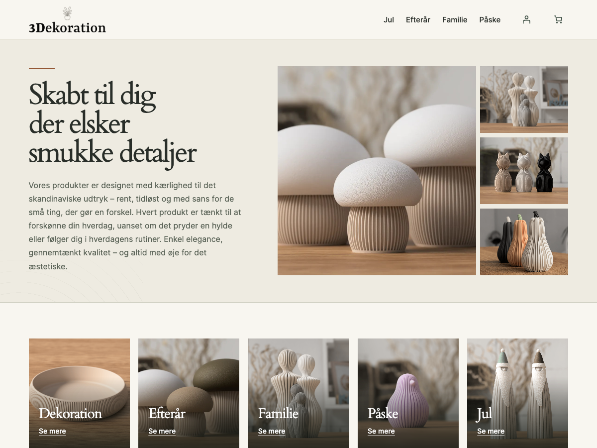

# 3Dekoration Japandi

Et WordPress-child-tema til [3dekoration.dk](https://3dekoration.dk/) og butikkens eksisterende Twenty Twenty-Four- og WooCommerce-blokke. Forsiden bruger de fire oprindelige billedlinks, de fem kategorier og det dynamiske produktudvalg.



## Installation

1. Behold **Twenty Twenty-Four** installeret. Temaet kræver WordPress 6.6 eller nyere og PHP 7.4 eller nyere. Brug butikkens eksisterende WooCommerce-installation.
2. Hent **3dekoration-japandi.zip** under *Assets* i [seneste release](https://github.com/kw-aficionado/3dekoration-japandi/releases/latest).
3. Åbn **Udseende → Temaer → Tilføj nyt tema → Upload tema**. Vælg ZIP-filen, installér og aktivér **3Dekoration Japandi**.
4. Til den første gennemgang kan du aktivere temaet på en stagingkopi af butikken. Så vises også de gemte sidehoveder, sidefødder og butiksskabeloner. WordPress’ forhåndsvisning før første aktivering kan vise grundtemaets standarddele.

### Hvad der følger med

Ved første aktivering kopierer temaet de publicerede skabeloner og skabelondele fra Twenty Twenty-Four, brugerens globale typografi- og layoutindstillinger, ekstra CSS samt relevante temaindstillinger til sin egen plads i WordPress. Et tidligere redigeret Japandi-layout har forrang. Efterfølgende redigering foretages som normalt i webstedseditoren.

Sider, produktkategorier, produkter, medier og menuer beholder deres eksisterende ID’er. Produktpriser, lager, variationer, kurv og betaling håndteres fortsat af WooCommerce og butikkens plugins. På en tom WordPress-installation arver temaet Twenty Twenty-Fours standardindhold.

Du kan skifte tilbage ved at aktivere **Twenty Twenty-Four** under **Udseende → Temaer**. Begge temaer husker deres egne skabelontilpasninger.

## Automatiske opdateringer fra GitHub

Det aktive tema henter nye, stabile versioner fra dette private repository. Giv WordPress læseadgang én gang:

1. Opret en *fine-grained personal access token* i GitHub. Vælg kun `kw-aficionado/3dekoration-japandi` og giv **Contents → Read-only**.
2. Gem værdien som serverens miljøvariabel **TREDEKORATION_GITHUB_TOKEN**. Hvis din hosting bruger `wp-config.php`, kan du i stedet indsætte følgende før linjen, der indlæser `wp-settings.php`. Erstat eksempelværdien lokalt på serveren.

   ```php
   define( 'TREDEKORATION_GITHUB_TOKEN', 'INDSÆT_DIT_LÆSETOKEN_HER' );
   ```

3. Åbn **Kontrolpanel → Opdateringer** og vælg **Kontrollér igen**. Gå til **Udseende → Temaer → 3Dekoration Japandi** og vælg **Aktivér automatiske opdateringer**. WordPress installerer herefter nye releases ved sit almindelige opdateringstjek, når baggrundsopdateringer er tilladt på hosten.

Et udløbet token kan udskiftes samme sted. En fejl ved hentning af releaseoplysninger vises på temasiden og opdateringssiden. Temaet verificerer ZIP-filens SHA-256 mod GitHubs releaseoplysninger inden installation.

## Udgiv en ny version

1. Opdatér `Version` i `style.css`, og læg de færdige ændringer på `main`.
2. Opret et annoteret Git-tag med samme versionsnummer. Ved eksempelvis version 1.0.1 bruges `git tag -a v1.0.1 -m "Beskriv ændringen"` og `git push origin v1.0.1`.
3. GitHub Actions kontrollerer PHP, tester opdateringsfunktionen og skabelonarven i WordPress, sammenholder version og tag og udgiver den installerbare ZIP under **Releases**. Kun udgivne versioner tilbydes butikkerne.

En lokal pakke bygges med `python3 scripts/package.py` og ligger i `dist/3dekoration-japandi.zip`. ZIP-filen har den faste WordPress-mappe `3dekoration-japandi/`.
